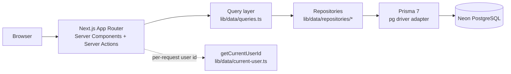
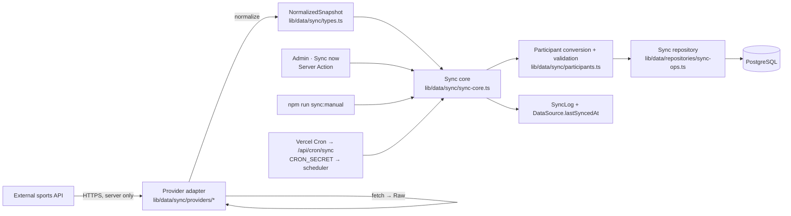
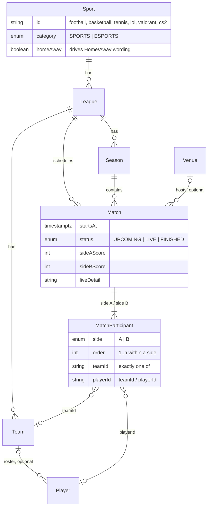
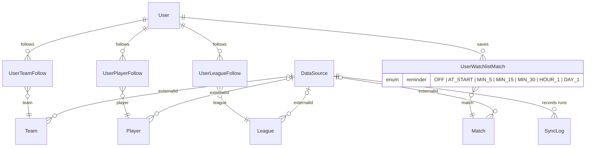

# MatchBase

**Personal Sports & Esports Command Center.**

One place to follow the teams, players and leagues you care about across traditional sports *and* esports, see what is on today, save the matches you do not want to miss, and set a reminder for each one.

```
Discover → Follow → Schedule → Watchlist → Reminder → Watch → History
```

MatchBase is a full-stack Next.js application backed by PostgreSQL. Its interesting parts are not the pages but the decisions underneath them: a participant-based match model that serves NBA, League of Legends and Wimbledon doubles from one schema, a data-driven sport registry that keeps sport-specific conditionals out of the UI, and a provider-agnostic sync pipeline whose first real adapter is the Sportradar Tennis API.

> **Status at a glance.** Fully working end to end against a Neon PostgreSQL database with deterministic demo data. Reminder *preferences* are persisted and shown; reminder *delivery* is not built. The Sportradar adapter is implemented and fixture-tested; it has **not** been run against the live API because no key is configured. There is no authentication yet (a single demo user). See [Current limitations](#current-limitations).

**Read next:** [Engineering case study](docs/case-study.md) · [Docs index](docs/README.md) · [Screenshot guide](docs/screenshots.md)

---

## Table of contents

1. [The problem](#the-problem)
2. [Product experience](#product-experience)
3. [Key features](#key-features)
4. [Key engineering challenges](#key-engineering-challenges)
5. [Architecture](#architecture)
6. [Domain model](#domain-model)
7. [Sports and esports in one system](#sports-and-esports-in-one-system)
8. [External data sync](#external-data-sync)
9. [Watchlist and reminders](#watchlist-and-reminders)
10. [Tech stack](#tech-stack)
11. [Project structure](#project-structure)
12. [Testing and validation](#testing-and-validation)
13. [Local development](#local-development)
14. [Environment variables](#environment-variables)
15. [Current limitations](#current-limitations)
16. [Roadmap](#roadmap)

---

## The problem

A fan who follows an NBA team, a League of Legends roster and a couple of tennis players has no single schedule. Each sport has its own apps, its own vocabulary ("home/away", "blue side", "seed"), and its own notion of what a match even is. Aggregators either flatten everything into a generic "Team A vs Team B" list that breaks for doubles and individual sports, or they special-case each sport until the codebase is a pile of `if (sport === ...)` branches.

MatchBase treats *following* as the primary act. Everything a user follows, across every discipline, feeds one dashboard, one schedule, one watchlist and one history. The engineering goal is to make that possible without the domain model or the UI having to know which sport it is looking at.

## Product experience

| Step | What the user does | Where |
|---|---|---|
| **Discover** | Browse leagues, teams and players across Sports and Esports, filtered by the category → sport → league hierarchy | `/teams`, `/players`, `/leagues/[id]`, `/matches` |
| **Follow** | Follow teams, players and leagues; follows persist per user | Follow buttons on team and player cards and detail pages |
| **Schedule** | See followed fixtures by day on a date strip, with live matches first | `/dashboard`, `/schedule` |
| **Watchlist** | Star any match to save it | Star on every match row; `/watchlist` |
| **Reminder** | Choose when to be reminded (at start, 5 min … 1 day before); the choice appears on the match page, the watchlist, the dashboard and the header bell | `/matches/[id]`, `/watchlist` |
| **Watch** | Open the match: participants, score, live detail, related matches | `/matches/[id]` |
| **History** | Review finished results across everything followed | `/history`, team and player result tabs |

An **Admin** workspace (`/admin`) manages the catalogue (sports, leagues, seasons, teams, players, venues, matches) and the operational side (data sources, sync logs, a "Sync now" action). It is deliberately plain: its job is to show the model and the sync pipeline, not to be a product surface.

## Key features

- **Cross-discipline catalogue.** Football, basketball and tennis alongside League of Legends, Valorant and Counter-Strike 2, all under one `Category → Sport → League → Season` hierarchy and one set of filters.
- **Participant-based matches.** A match is two *sides* of participants. A side holds one team, one player (tennis singles) or two players (doubles). The same row shape and the same components render "Lakers vs Celtics", "T1 vs Gen.G" and "Hsieh / Ostapenko vs Krejčíková / Siniaková".
- **Home/Away as metadata, not schema.** Whether a sport has a home side is a property of the sport. Football shows "Home / Away"; esports and tennis show plain sides. No page checks the sport.
- **Persistent user state.** Follows (teams, players, leagues), watchlist and per-match reminder preferences live in PostgreSQL, keyed by a user id that is resolved in exactly one function.
- **Optimistic client stores with server reconciliation.** Follow and watchlist toggles update instantly, call a Server Action, and roll back with the server's reason on rejection (for example "This match has already started").
- **Provider-agnostic sync.** One generic pipeline ingests any provider through a `fetch → normalize` adapter contract. A deterministic mock basketball feed and a real Sportradar Tennis adapter both run through it unchanged.
- **Operational visibility.** Every sync run writes a `SyncLog` (SUCCESS / PARTIAL / FAILED, record counts, duration, classified error). Admin shows whether a source is a placeholder, a mock, or a live provider and whether it is configured.
- **Light and dark themes, responsive shell** with a sidebar on desktop and a four-item bottom navigation on mobile.

## Key engineering challenges

### 1. The home/away assumption did not generalise

The first schema had `Match.homeTeamId` and `Match.awayTeamId`. That works for the NBA and the Premier League and breaks the moment the catalogue grows:

| Format | What a match needs | Why `homeTeamId / awayTeamId` fails |
|---|---|---|
| NBA, EPL | one team per side, a home side | fine |
| LoL, Valorant, CS2 | one team per side, **no** home side | "home" is a lie the UI has to hide |
| Tennis singles | one **player** per side, no team | there is no team to reference |
| Tennis doubles | **two** players per side | there is no single participant per side |
| Free agents / independent players | a player with `teamId = null` | players only reachable through a team |

**Decision.** Replace the two team columns with a `MatchParticipant` table: `(matchId, side A|B, order, teamId?, playerId?)` with a database `CHECK` that exactly one of team/player is set. Scores move to positional `sideAScore / sideBScore`. Shared, side-effect-free validation (`lib/data/match-participants.ts`) is applied by every writer: the admin form, the sync pipeline and the seed.

**Result.** Two migrations: one adds the table and backfills a participant per legacy column, the next re-verifies every backfilled row inside a `DO $$` guard and only then drops the legacy columns. Match Detail, rows, scoreboards and search all read participants through a handful of pure helpers (`sideName`, `sideRole`, `winnerSide` in `lib/matches.ts`). Once the participant model existed, tennis singles and doubles needed a provider adapter, not another schema change. Full narrative: [docs/case-study.md](docs/case-study.md), analysis: [docs/match-participant-model-analysis.md](docs/match-participant-model-analysis.md).

### 2. Sports and esports without page-level conditionals

`Category` (SPORTS | ESPORTS) is an enum, `Sport` is a table (and a typed code registry), `League` belongs to a sport. Everything that differs between disciplines is a **property of the sport** in `lib/sports.ts`, currently `label`, `category` and `homeAway`. Components ask `sideRole(sport, side)` and get "Home", "Away" or nothing. Filters, breadcrumbs ("Esports · League of Legends · LCK"), icons and detail pages are the same code for every discipline. Adding tennis was a registry entry and a seed row.

### 3. A sync pipeline that knows nothing about any provider or sport

```
External API ──▶ Provider adapter ──▶ NormalizedSnapshot ──▶ Sync core ──▶ Sync repository ──▶ PostgreSQL
                 (fetch, normalize)   (MatchBase vocabulary)  (generic)     (upsert by external id)
```

- **Raw payloads never leave the adapter file.** The adapter's `Raw` type parameter is private; it maps its provider's vocabulary to MatchBase sport codes and statuses.
- **The sync core iterates entities generically** in dependency order (leagues → seasons → venues → teams → players → matches), upserting each record independently by `(dataSourceId, externalId)` so internal ids, follows, watchlist rows and routes survive re-syncs. A bad record fails alone; the run ends SUCCESS, PARTIAL or FAILED.
- **The browser never talks to the provider.** Syncs run in a Server Action, a CLI script, or the authenticated cron route, credentials are read from the environment on the server, and every recorded message is scrubbed of secrets. A build-output scan confirms no `SPORTRADAR`, `THESPORTSDB` or `CRON_SECRET` string reaches the client bundle.
- **Scheduled sync shares the pipeline.** A Vercel Cron Job calls one route that authenticates with `CRON_SECRET` and runs a provider-neutral scheduler; the scheduler calls the same `runSync` the CLI and Admin use. A database-backed lock (the RUNNING sync log, taken under a row lock) keeps concurrent invocations from syncing one source twice, with stale-lock recovery. Admin shows each source's freshness.
- **HTTP concerns are shared utilities**: timeouts, bounded retries for 429/5xx/timeouts only, `Retry-After` handling, a rate limiter, and injectable `fetch` and `sleep` so all of it is unit-tested without a network.

The Sportradar Tennis adapter exercises the hardest path (paged season summaries, singles and doubles, "Last, First" names, offset timestamps, unmapped statuses) and is the first real provider.

### 4. Watchlist and reminders as one persisted relationship

A reminder is a property of the user's relationship with a match, so it lives on `UserWatchlistMatch.reminder` (enum `OFF … DAY_1`), not in a new table. Rules are one pure function (`validateReminderChange`) shared by the repository and the UI: only saved, upcoming matches can have a reminder; removing the match removes the reminder; `off` keeps the match saved. **What exists** is the preference, its validation, its persistence, and its presentation on four surfaces (match page, watchlist, dashboard, header bell). **What does not exist** is any delivery: no scheduler, no worker, no push or email. The header bell is where in-app delivery would surface later.

## Architecture

### Read path



- **Pages and server components** call query functions only. Nothing outside `lib/data` touches Prisma.
- **Query layer** composes repositories, resolves the current user once per request (`React.cache`), and applies sorting and window logic.
- **Repositories** own Prisma queries and map rows to domain view types (`MatchView`, `TeamView`, …). Writes go through `lib/data/user-state-actions.ts` and `lib/data/admin-actions.ts` (Server Actions), which validate and then call repositories.
- **Client stores** (`components/*/…-provider.tsx`) are seeded by the layout from server data and hold optimistic follow, watchlist and reminder state; they re-sync after every action.

### Write path for external data



The sync core takes an injected repository and provider resolver, so the database tests run the real pipeline inside rolled-back transactions and the CLI script runs the same code the Admin button runs.

## Domain model





Conventions worth knowing:

- **Ids are strings.** Seeded rows keep readable slugs (`arsenal`, `m-epl-ars-che`); everything created later gets a `cuid()`.
- **Instants are `timestamptz` in UTC**; season bounds are calendar dates.
- **Deletes are conservative.** Domain parents are `Restrict`, optional references `SetNull`, user join rows and sync logs `Cascade`.
- **Match status is stored data**, transitioned by the sync process, never inferred from the clock by the UI.
- **External identity** `(dataSourceId, externalId)` is a composite unique on League, Team, Player, Venue and Match. Seasons reconcile by `(leagueId, name)`.
- **Database `CHECK` constraints** back the participant rules: exactly one of team/player per row, positive order, paired scores.

Full schema: [prisma/schema.prisma](prisma/schema.prisma). Every decision with its rationale: [docs/data-model-decisions.md](docs/data-model-decisions.md).

## Sports and esports in one system

| Concern | Where it lives | Example |
|---|---|---|
| Top-level grouping | `Category` enum | Sports, Esports |
| Discipline | `Sport` row + `sportMeta` registry (`lib/sports.ts`) | `lol` → "League of Legends", esports, no home side |
| Competition | `League` row | LCK, NBA, "Wimbledon Men Singles" |
| Side wording | `sideRole(sport, side)` | Home / Away, or nothing |
| Icons | `lib/sport-icons.tsx` | per sport, one component |
| Participant rendering | `SideName`, `ParticipantAvatars` | team crest, player portrait, or overlapped pair |
| Hierarchy filters | `components/filters/hierarchy-filters.tsx` | Category → Sport → League |

Tennis players are stored as `Player` rows with `teamId = null`, are listed as "Independent", can be followed, and their detail page lists their matches directly through `MatchParticipant`, no team required.

## External data sync

Three providers are registered in `lib/data/sync/providers/registry.ts`:

| Provider | Kind | Bound DataSource | Purpose |
|---|---|---|---|
| `mock-basketball` | mock | `ds-mock-basketball` | deterministic fixtures relative to the run time; drives pipeline, idempotency and PARTIAL-run tests |
| `sportradar-tennis` | live | `ds-tennis-sportradar` | Sportradar Tennis API v3: competitions → seasons → paged summaries; singles and doubles |
| `thesportsdb-epl` | live | `ds-thesportsdb-epl` | TheSportsDB V1 free API, English Premier League: league → team list → season, next, previous and day schedules; **verified against the live API** |

What the pipeline guarantees (all covered by tests):

- **Idempotent**: running the same snapshot twice yields `created 0, updated n`, identical ids, identical participants, one more log row.
- **Partial failure isolation**: a malformed record fails alone and the run is marked PARTIAL with the offending external id in the log.
- **Status safety**: an unmapped provider status never becomes FINISHED; the stored status is kept and a warning recorded.
- **Time safety**: provider instants with any offset are stored as UTC; an unparseable time fails only that record.
- **Secret safety**: credentials travel only in a request header and are redacted from every recorded message.

Admin → Data Sources shows each source's state precisely: "None (placeholder)", "Mock · Deterministic fixtures", "Live · Not configured · SPORTRADAR_API_KEY is not set", or "Live · Configured · credentials present, not yet verified against the live API".

Details: [docs/external-data-sync-architecture.md](docs/external-data-sync-architecture.md), [docs/live-data-integration.md](docs/live-data-integration.md), [docs/tennis-provider.md](docs/tennis-provider.md), [docs/providers/thesportsdb.md](docs/providers/thesportsdb.md).

## Watchlist and reminders

```
User ──< UserWatchlistMatch >── Match
              │
              └── reminder: OFF | AT_START | MIN_5 | MIN_15 | MIN_30 | HOUR_1 | DAY_1
```

| Situation | Behaviour |
|---|---|
| Star a match | row created with `reminder = OFF` |
| Set a reminder on a saved upcoming match | stored; shown on Match Detail, Watchlist, Dashboard and the header bell |
| Set `off` | reminder cleared, match stays saved |
| Un-star the match | row deleted, reminder goes with it |
| Reminder on a match that is not saved, is live, or is finished | rejected with a reason; the UI disables the control with the same reason |

`getReminderAt(startsAt, reminder)` is pure arithmetic on the UTC instant. The scheduler, delivery log and channels that would consume it are **not implemented**; see [docs/watchlist-reminders.md](docs/watchlist-reminders.md) for the intended future shape.

## Tech stack

| Layer | Choice | Notes |
|---|---|---|
| Framework | Next.js 16 (App Router), React 19, React Compiler | Server Components for reads, Server Actions for writes |
| Language | TypeScript (strict) | domain types in `lib/data/types.ts` |
| Styling / UI | Tailwind CSS v4, shadcn components on Base UI, lucide icons, `next-themes` | light and dark |
| Database | PostgreSQL on Neon | pooled URL for the app, direct URL for migrations |
| ORM | Prisma 7 with `@prisma/adapter-pg` | generated client in `lib/generated/prisma` (git-ignored) |
| Tests | Node's built-in test runner via `tsx` | domain, sync and database suites |
| Lint | ESLint 9 with `eslint-config-next` | |

## Project structure

```
app/
  (app)/                    user-facing routes and the admin workspace
    dashboard/ schedule/ matches/[id] watchlist/ teams/[id] players/[id] leagues/[id] history/
    admin/                  sports, leagues, seasons, teams, players, venues, matches,
                            data-sources, sync-logs (+ analytics/monitoring/settings placeholders)
components/
  matches/ schedule/ watchlist/ reminders/ teams/ players/ dashboard/ history/   feature UI
  admin/                    generic data table, form dialogs, per-entity views
  layout/ filters/ ui/      shell, hierarchy filters, shadcn primitives
lib/
  data/
    queries.ts              read API used by pages
    user-state-actions.ts   follow / watchlist / reminder Server Actions
    admin-actions.ts        catalogue CRUD Server Actions
    current-user.ts         the one place that knows who the user is
    match-participants.ts   shared participant validation rules
    repositories/           Prisma access, one file per aggregate (+ sync-ops, watchlist-reminder-ops)
    sync/                   provider contract, sync core, participants conversion, HTTP utils
      providers/            mock-basketball, sportradar-tennis, registry
  sports.ts                 sport registry (label, category, homeAway)
  matches.ts                pure presentation helpers over participants
  reminders.ts              reminder arithmetic and labels
  watchlist/                reminder rules, client store
prisma/
  schema.prisma  migrations/  seed.ts (idempotent; demo timeline laid over the current date)
scripts/sync-data-source.mts   manual CLI sync of one DataSource
app/api/cron/sync/route.ts     Vercel Cron trigger → lib/api/cron-sync.ts → lib/data/sync/scheduler.ts
vercel.json                    the cron schedule (daily, UTC)
tests/
  domain/  sync/  db/       see Testing
docs/                       design decisions, architecture, case study
```

## Testing and validation

```bash
npm test           # Node test runner through tsx: tests/**/*.test.ts (112 tests)
npm run lint       # ESLint
npm run typecheck  # TypeScript
npm run build      # prisma generate && prisma migrate deploy && next build
```

| Suite | Files | What it proves |
|---|---|---|
| `tests/domain` | match-participants, matches, reminders | participant rules (both sides, one ref, unique positions, homogeneous sides, one team per side), singles/doubles naming and winner logic, every reminder option and validation rule |
| `tests/sync` | http, participants, sportradar-tennis | retry/backoff/`Retry-After`/timeout classification with injected transport and clock; conversion of both normalized match shapes; the tennis adapter end to end against fixtures (config failure without network, 403, pagination via `X-Max-Results`, singles and doubles, statuses, time zones, malformed-record isolation, determinism) |
| `tests/db` | sync-pipeline, watchlist-reminders | the real pipeline and reminder persistence against PostgreSQL inside rolled-back transactions (idempotency, PARTIAL runs, sync-log content, reminder rules). Skipped automatically when no database URL is set |

None of `npm test`, `npm run build`, `npm run lint` or the seed ever calls the network.

## Local development

Requirements: Node 20.12+ (uses `process.loadEnvFile`), a PostgreSQL database (the project is set up for [Neon](https://neon.tech), but any PostgreSQL with two connection strings works).

```bash
npm install
cp .env.example .env.local        # fill in DATABASE_URL and DATABASE_URL_UNPOOLED
npx prisma generate               # generate the client into lib/generated/prisma
npm run db:migrate                # apply migrations (uses the direct URL)
npm run db:seed                   # idempotent demo catalogue + demo user state
npm run dev                       # http://localhost:3000 → /dashboard
```

Optional:

```bash
npm run sync:manual -- ds-mock-basketball     # run the mock provider through the real pipeline
npm run sync:manual -- ds-tennis-sportradar   # requires SPORTRADAR_API_KEY; calls the live API
npm run sync:manual -- ds-thesportsdb-epl     # calls the live TheSportsDB free API (about 75 s, 25 paced requests)
PRISMA_QUERY_LOG=1 npm run dev                # print every SQL statement
```

The seed lays a fixed timeline of offsets ("live now", "tomorrow 21:00 Taipei", "finished yesterday") over the current date, floored to the half hour, so the Dashboard, Schedule, Watchlist and History are populated whenever you seed. Set `DEMO_ANCHOR=2026-09-14` to reproduce a specific demo state. Tests and provider fixtures never use the wall clock. Details: [docs/demo-data-and-time.md](docs/demo-data-and-time.md).

## Environment variables

All variables are server-only. None is prefixed `NEXT_PUBLIC_`, none is imported by client code. Copy [.env.example](.env.example) to `.env.local` (git-ignored).

| Variable | Required | Purpose |
|---|---|---|
| `DATABASE_URL` | yes | pooled connection used by the application at runtime |
| `DATABASE_URL_UNPOOLED` | yes | direct connection used by the Prisma CLI (migrations, seed) and the manual sync script |
| `SPORTRADAR_API_KEY` | for a live tennis sync | sent as `x-api-key`; without it the tennis source reports "Not configured" and a sync records a FAILED run without making a request |
| `SPORTRADAR_TENNIS_ACCESS_LEVEL` | no (`trial`) | must match the key |
| `SPORTRADAR_TENNIS_BASE_URL`, `_LANGUAGE`, `_SEASON_YEAR`, `_LEVELS`, `_COMPETITIONS`, `_REQUEST_INTERVAL_MS` | no | scope and pacing of the tennis sync; see `.env.example` |
| `THESPORTSDB_API_KEY` | no (public free key `123`) | TheSportsDB V1 key, placed in the URL path on the server only |
| `THESPORTSDB_BASE_URL`, `_REQUEST_INTERVAL_MS`, `_PAST_DAYS`, `_FUTURE_DAYS`, `_MAX_REQUESTS`, `_SEASON` | no | pacing, day window, per-run request budget and season override; see `.env.example` |
| `CRON_SECRET` | for scheduled sync | sent by Vercel Cron as a Bearer token; the route refuses to run without it (at least 16 characters) |
| `SYNC_*_MINUTES` | no | cadence tuning for freshness, the recency gate, the time budget and stale-lock recovery; see `.env.example` |
| `PRISMA_QUERY_LOG` | no | `1` prints SQL |

## Current limitations

Stated precisely, because the difference matters:

| Area | What exists | What does not |
|---|---|---|
| **Sportradar integration** | Adapter implemented; configuration validation, auth handling, pagination, normalization, persistence, idempotency and secret redaction verified against fixtures shaped like the documented API | **No run against the live API.** `SPORTRADAR_API_KEY` is not configured in any environment used so far. Real response shapes, authentication, rate limits, freshness and catalogue coverage are unverified |
| **TheSportsDB integration** | Adapter implemented and **run twice against the live V1 free API** for the Premier League: real fixtures, results, clubs, badges and venues ingested through the generic pipeline, idempotent | Free-tier listings are truncated (10 teams, 5 to 15 season events, 3 per day, 1 next and previous), so coverage is a window around the run, not a full season. No live match was observed, so live-phase statuses are fixture-tested only. Players are not synced |
| **API credentials** | Read from the environment on the server; never in source, URLs or logs | No credential storage beyond environment variables |
| **Demo data** | Deterministic timeline from `lib/data/mock.ts`, seeded relative to the current date (or `DEMO_ANCHOR`), idempotent, coherence-checked | It is still demo data: nothing advances between seeds, "live" matches are authored fixtures, and re-seeding is the only refresh |
| **Authentication** | `getCurrentUserId()` is the single seam; all user tables are keyed by user id | No login, sessions or roles. Every request is the seeded demo user |
| **Reminders** | Preference persisted per watchlisted match, validated, shown on four surfaces | **No notification is ever delivered.** No scheduler, worker, push, email or in-app delivery log |
| **Synchronization** | Manual (Admin "Sync now", `npm run sync:manual`) and scheduled: a daily Vercel Cron Job through `/api/cron/sync` with a database-backed run lock and Admin freshness; see [docs/scheduled-sync.md](docs/scheduled-sync.md) | Daily only, because Vercel Hobby allows nothing more frequent; no live-score streaming, no deletion reconciliation, no `DataSource.provider` column (binding is in code) |
| **Time zones** | Instants stored in UTC; reminder arithmetic is zone-free | Day boundaries ("today", schedule days) use the server's local time; the decided Asia/Taipei presentation zone is not applied yet |
| **Admin** | Catalogue CRUD, data sources, sync logs | Analytics, Monitoring and Settings are reserved "Coming soon" placeholders |
| **Match detail** | Aggregate score per side, live detail string | No per-set / per-map scores, rankings or seeds |

## Roadmap

Next phase candidates, in rough priority order. None is started.

1. **Verify the live Sportradar path** with a real key: run the documented smoke test, record observed response shapes, fix any adapter assumptions. (TheSportsDB is already live-verified for one league; a second league is a registry binding.)
2. **Authentication** behind the existing `getCurrentUserId()` seam; the user tables need no change.
3. **Reminder delivery**: a scheduler over `UserWatchlistMatch × Match.startsAt`, an idempotent delivery log, and one channel (in-app via the header bell first).
4. A `DataSource.provider` column so bindings live in data (scheduled synchronization itself now exists).
5. **Presentation time zone** applied to day boundaries (the seed already evaluates its timeline in Asia/Taipei).
6. A second team-sport provider to prove the "one adapter file, one registry entry, one DataSource row" claim against a live feed.

---

Design and decision records live in [docs/](docs/README.md). Start with the [case study](docs/case-study.md).
