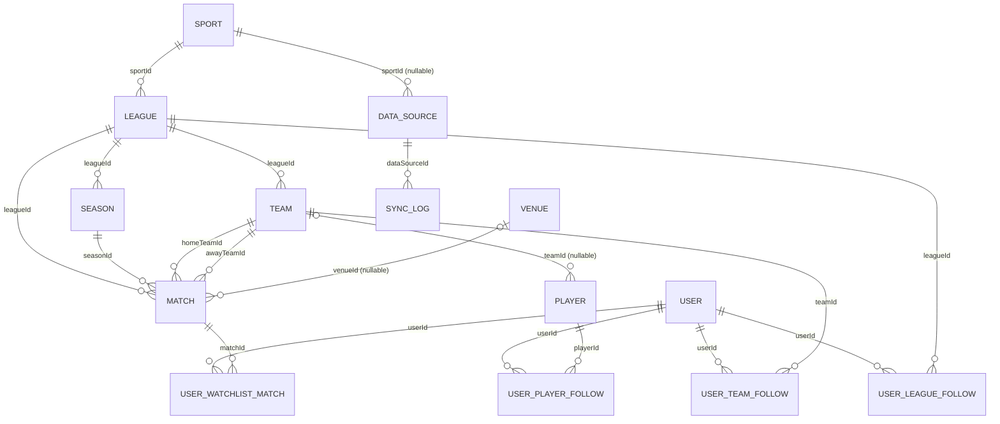

# MatchBase Data Model & Architecture Audit

## Status

- Audit status: Completed 2026-09-12. **Historical document, superseded.**
- Schema implementation: Complete since 2026-09-13 (`prisma/schema.prisma`); see `docs/data-model-decisions.md` for the contract that was built
- Prisma/PostgreSQL migration: Applied (four migrations, 2026-09-13 to 2026-09-15)
- Purpose: Baseline record of the mock-data codebase and the reasoning that led to the PostgreSQL model

> **How to read this in 2026-09-17 terms.** Sections 1 to 4 describe the codebase as it was *before* the database existed (mock arrays, client-side stores, no User entity); none of that is current. Sections 5 to 8 were proposals; they were implemented with the deviations recorded in `docs/data-model-decisions.md` ("Prisma Schema Implementation Notes"). The most important later change is that section 6's recommendation to keep `homeTeamId` / `awayTeamId` was reversed on 2026-09-15 by the participant model (`docs/match-participant-model-analysis.md`, decisions section 6). The document is kept because it records *why* each decision was made.

This document records what the code contained at the time and what the PostgreSQL model should look like. The two are kept strictly separate: sections 1 to 4 describe the state at the time, sections 5 to 8 describe the proposals as they stood before implementation.

Source files inspected for the current state: `lib/data/types.ts`, `lib/data/mock.ts`, `lib/data/queries.ts`, `lib/sports.ts`, `lib/schedule.ts`, `lib/teams.ts`, `lib/players.ts`, `lib/format.ts`, the id-set and collection stores under `lib/`, the follow/watchlist providers, the Admin data provider and CRUD views under `components/admin/`, the match/team/player components, and every route under `app/(app)/`.

---

## 1. Current Domain Model

### 1.1 Classification

| Concept | Classification | Where it lives today |
|---|---|---|
| Category | Enum / union type (`"sports" \| "esports"`) plus a label registry | `types.ts`, `sports.ts` |
| Sport / Game | Enum / union type (`football`, `basketball`, `lol`, `valorant`, `cs2`) plus the code-level `sportMeta` registry (label, category, `homeAway`) | `types.ts`, `sports.ts` |
| SportRecord | Derived at runtime for Admin only. `getAdminData` synthesizes every sport as `active`; sport status is never stored, not even in mock data | `queries.ts`, `types.ts` |
| League | Current domain entity (mock array, 7 rows) | `mock.ts` |
| Season | Current domain entity (mock array, 10 rows). League additionally carries a duplicated `season` string label | `mock.ts`, `types.ts` |
| Team | Current domain entity (mock array, 27 rows) | `mock.ts` |
| Player | Current domain entity (mock array, 23 rows) | `mock.ts` |
| Match | Current domain entity (mock array, 20 rows). Start times are generated relative to `now` when the module loads | `mock.ts` |
| Match participants | Two fixed slots `homeTeamId` / `awayTeamId` and `score.{home,away}`. No generic participant structure exists | `types.ts` |
| Venue | Current domain entity (mock array, 12 rows). Match holds only a free-text `venue` string; linking is by name equality | `mock.ts`, `types.ts` |
| Data Source | Current domain entity (mock array, 6 rows) with an optional `sport` scope | `mock.ts` |
| Sync Log | Current domain entity (mock array, 12 rows) with an explicit `dataSourceId` | `mock.ts` |
| AdminActivity | Temporary mock-data representation (free-text `entity` and `actor`), display only | `mock.ts` |
| User | Conceptual future entity only. No entity, no id, no authentication. The sidebar hardcodes "Guest" | `app-sidebar.tsx`, `nav-user.tsx` |
| Followed Team / Player / League | Temporary mock singleton `currentUserFollows` (id arrays with no user id) seeding client-side id-set stores | `mock.ts`, `app/(app)/layout.tsx` |
| Watchlist Match | Same mock singleton (`watchlistMatchIds`) seeding a client-side id-set store | `mock.ts`, `app/(app)/layout.tsx` |
| MatchView / PlayerView / TeamView | Derived at runtime (joins), never stored | `queries.ts` |
| QuickStats | Derived at runtime from follows and leagues | `queries.ts` |

### 1.2 What each classification means

- **Domain entity**: a record type with an id, held in a mock array, that clearly maps to a future table.
- **Code-level registry**: constants in `lib/sports.ts` that drive labels, category membership, and Home/Away behaviour. Nothing in the mock data stores a category.
- **Derived value**: computed in `queries.ts` or in components from other records (joined views, next match per team, winner from score, category from sport, day grouping).
- **UI / client state**: filter state, editor drafts, sort and pagination, plus the id-set stores (watchlist, team follows, player follows) and the Admin collection stores.
- **Temporary mock-data representation**: shapes that only make sense while data is hand-written (free-text venue, `League.season` label, relative timestamps, slug ids, the follows singleton, always-active sport status, AdminActivity).
- **Conceptual future entity**: User. It does not exist in any form other than a hardcoded display name.

### 1.3 Current relationship diagram

```
Category (enum)  ──registry──▶  Sport (enum + sportMeta)
                                    │ League.sport (string code, inferred FK)
                                    ▼
                                 League ──1:N──▶ Season   (Season.leagueId, explicit)
                                    │ ──1:N──▶ Team     (Team.leagueId, explicit)
                                    │ ──1:N──▶ Match    (Match.leagueId, explicit)
                                 Team ──1:N──▶ Player   (Player.teamId, explicit)
                                 Match ──2 FKs──▶ Team  (homeTeamId, awayTeamId)
                                 Match ··name··▶ Venue  (free text, inferred)
                                 Match ✗ Season         (no link at all)
                                 DataSource ──1:N──▶ SyncLog (dataSourceId, explicit)
                                 DataSource ··code··▶ Sport (optional string code)
                                 currentUserFollows ──ids──▶ Team, Player, League, Match
```

---

## 2. Current Data Ownership

| Data | Source today | Notes |
|---|---|---|
| Category, Sport metadata | Code registry | `lib/sports.ts` drives labels, category, and Home/Away wording everywhere |
| Sport status | Derived (Admin only) | Synthesized at request time; edits live only in the Admin client store |
| League, Season, Team, Player, Match, Venue, DataSource, SyncLog, AdminActivity | Mock arrays | `queries.ts` is the only module that imports `mock.ts` |
| Follows and watchlist (initial values) | Mock singleton | Read by four seed queries and by `getTodaysMatches`, `getUpcomingFollowedMatches`, `getQuickStats` |
| Follows and watchlist (after interaction) | Client state | Three id-set providers mounted in the app layout; toggles never reach the server |
| Admin collections | Client state (Admin state) | `AdminDataProvider` copies every array into a `CollectionStore`; `newId()` generates browser ids; nothing persists beyond the session |
| Joined views, next match, winner, category, day groups | Derived logic | `toMatchView`, `toTeamViews`, match row and scoreboard components, `lib/schedule.ts` |
| Filter state, drafts, sort, pagination | UI state | View hooks and `useEntityEditor` |

### 2.1 Inconsistency 1: dashboard follow data versus mock-backed server queries

The dashboard mixes two owners of the same fact. "Followed teams" and the stat cards read the client id-set store, so they react when the user toggles a follow. "Today's matches" and "Upcoming matches" call server queries that read the `currentUserFollows` mock singleton, so they do not. Both start from the same seed list and diverge as soon as the user interacts. This resolves itself once follows persist and both paths read the database.

### 2.2 Inconsistency 2: Admin edits do not update user-facing data

Admin and user-facing pages share the same source arrays, but the Admin holds a separate client-side copy in `CollectionStore`s. Creating, editing, or deleting in Admin changes only that copy. User-facing pages keep reading the untouched mock. There is no separate `admin*` domain model, which is the correct starting point for the database: the Admin already manages the same entities users consume.

Other Admin-versus-user differences observed:

- Admin views work on raw records; user pages work on joined views (`MatchView`, `TeamView`, `PlayerView`).
- The Admin match form restricts both teams to the match's league; the query layer does not enforce this.
- Admin filters entity status using `status ?? "active"`; user-facing queries do not filter by status at all, so inactive leagues, teams, and players still appear on user pages.
- Admin delete dialogs leave dangling ids on dependent records by design ("keep their league id until reassigned").

---

## 3. Current Relationships

| Relationship | Representation | Explicit or inferred | Cardinality | Natural future form |
|---|---|---|---|---|
| Category → Sport | `sportMeta[sport].category` lookup; never stored on any record | Registry (inferred) | 1:N | Enum column on Sport |
| Sport → League | `League.sport` holds the sport code as a string | Inferred (no referential check possible) | 1:N | FK to a Sport table |
| League → Season | `Season.leagueId` | Explicit | 1:N | FK |
| League → Team | `Team.leagueId`, single value. Real Madrid and Bayern exist only in the "ucl" league because a team cannot belong to two competitions | Explicit | 1:N | FK (join table later if needed) |
| League → Match | `Match.leagueId`, required; `toMatchView` throws if missing | Explicit | 1:N | FK, NOT NULL |
| Team → Player | `Player.teamId`, single value, no history | Explicit | 1:N | FK, nullable |
| Match → Team | `homeTeamId` and `awayTeamId`, both required | Explicit | Two FKs | Two FKs, NOT NULL, CHECK distinct |
| Match → League | See League → Match | Explicit | N:1 | FK |
| Match → Season | Does not exist | Absent | – | FK (new) |
| Match → Venue | `match.venue === venue.name` in the Admin venues view and an unused `venueByName` map in the Admin data provider. The mock file itself says this is temporary | Inferred by name | N:1 | Nullable FK |
| DataSource → SyncLog | `SyncLog.dataSourceId` | Explicit | 1:N | FK |
| DataSource → Sport | `DataSource.sport` optional string code | Inferred | N:1 | Nullable FK |
| User → Team / Player / Match | Id arrays on `currentUserFollows`, no user id | Mock singleton | M:N in shape | Join tables |
| User → League | `leagueIds` exists server-side only. No client store, no follow button. Drives the dashboard "Today's matches" filter and the "Followed leagues" stat | Mock singleton | M:N in shape | Join table (if the feature is kept) |

Relationships that are inferred rather than explicit: Category → Sport, Sport → League, DataSource → Sport, and Match → Venue. Match → Season is missing entirely.

---

## 4. Schema Debts

Items are labelled by when they should change. "Required" means the schema should not be written without resolving it. "Recommended for v1" means cheap now and painful later. "Deferred" means there is no concrete product requirement yet.

### 4.1 Required before PostgreSQL schema

| # | Debt | Current implementation | Problem | Recommended direction |
|---|---|---|---|---|
| 1 | Match ↔ Venue by name | `Match.venue` is free text; Venue records are matched by `name` equality | Works only because mock strings are copied verbatim. Renaming a venue silently orphans matches (the Admin delete dialog admits this) | Nullable `venueId` FK on Match; drop the free-text field. Read-side impact is the match detail page and scoreboard only |
| 2 | `League.season` duplication | League carries a `season` label and Season records exist separately | Two sources of truth that drift. Read on the match detail page, team detail page, the Admin league form, and as a fallback on the league page (which already prefers the Season record) | Remove the label; derive "current season" from the Season table |
| 3 | Match ↔ Season | No link | Every mock match belongs to a league whose current season is unambiguous, so it was never needed. History, standings, and per-season results all need it | Required `seasonId` FK on Match |
| 4 | Sport as a persisted entity | TypeScript union plus `sportMeta` registry; Admin shows a status that is synthesized as always active | `League.sport` and `DataSource.sport` are unchecked strings from the database's point of view; Admin status has nowhere to live | A `sport` table keyed by the same codes the code already uses (see section 5) |
| 5 | Entity status | `League`, `Team`, `Player` use optional `status`; every consumer writes `status ?? "active"`; `Venue.status` is required | Implicit default and inconsistent optionality | NOT NULL with default `active`. Decide separately whether user-facing queries hide inactive rows (today they do not filter at all) |
| 6 | User entity | Does not exist. Follows and watchlist are a mock singleton | Nothing user-specific can persist | Minimal `user` table plus four join tables. Authentication mechanism stays out of scope |

### 4.2 Recommended for v1

| # | Debt | Current implementation | Problem | Recommended direction |
|---|---|---|---|---|
| 7 | Score fields | `score?: { home, away }` embedded object | Not a relational shape; "both or neither" cannot be enforced | `homeScore` and `awayScore` integer columns, CHECK both null or both set |
| 8 | IDs | Hand-written slugs (`arsenal`, `m-epl-ars-che`) and browser-generated `newId()` strings for Admin-created rows | No uniqueness guarantee; browser ids are not durable | Keep `id` as text with a generated default for new rows and seed with the existing slugs so every route keeps working. A separate `slug` column can come later if ids become opaque |
| 9 | Timestamps and time zones | `Match.startsAt`, `SyncLog.at`, `DataSource.lastSyncedAt` are ISO strings; Season bounds are `YYYY-MM-DD`. `startOfDay`, `dayKey`, and `isSameDay` in `lib/format.ts` use the server's local time zone | "Today" depends on where the server runs | `timestamptz` and `date` columns; "today" queries take an explicit time zone parameter |
| 10 | Match status ownership | `Match.status` is stored, not derived. Works because the mock regenerates times relative to `now` on every process start | In a database a match stays `upcoming` forever unless a sync or job advances it | Not a schema change; the sync process must own `upcoming → live → finished` transitions |
| 11 | External identifiers | None exist on any entity | A fetcher cannot upsert without a stable provider key | `dataSourceId` + `externalId` columns (see section 7) |

### 4.3 Can be deferred

| # | Debt | Current implementation | Problem | Recommended direction |
|---|---|---|---|---|
| 12 | Teams in multiple leagues | Single `Team.leagueId` | Blocks cup plus domestic league. Match already has its own `leagueId`, so the database can hold cross-league matches; only the Admin form and `TeamView.league` assume one league | Defer a `league_team` join until a real second competition is needed |
| 13 | Player team history | Single `Player.teamId`, current team only | No transfer history | Defer a `team_membership` table |
| 14 | Match-team-league integrity | Admin form restricts team choice to the match's league; nothing else enforces it | A match could reference teams from another league | Composite FK later if needed |
| 15 | AdminActivity | Free-text `actor` and `entity`, mock only | `actor` has no user to point at | Keep as mock or derive from `updatedAt` until users exist |
| 16 | `stage`, `role`, `liveDetail` | Free text | None for v1 | Keep as text |
| 17 | Category table | Enum with two values, no attributes beyond a label, no CRUD | None | Keep as an enum on Sport |

---

## 5. Recommended PostgreSQL Domain Model

This section is a proposal. None of it exists in the codebase.

Labels: **[v1]** required for the first milestone, **[v1-rec]** recommended but the application works without it, **[later]** deferred.

### 5.1 Proposed tables

**Sport [v1]**
- Purpose: FK target for League and DataSource; persists the sport status the Admin sports view already edits.
- Fields: `id` (text, same codes as today: `football`, `lol`, …), `category` (enum `sports | esports`), `name`, `homeAway` (boolean, replaces `sportMeta.homeAway`), `status` (enum, default `active`), `sortOrder`.
- Primary key: `id`.
- Note: `lib/sports.ts` stays as the client-side registry seeded from the same rows in v1. Keeping the PK equal to the existing codes means `League.sport` values, route filters, and the registry keep working without renaming anything.

**League [v1]**
- Purpose: a competition within one sport or game.
- Fields: `id`, `sportId`, `name`, `shortName`, `region`, `status` (enum, default `active`). No season label.
- Primary key: `id`.
- Foreign keys: `sportId → Sport` (required).
- Unique: `(sportId, shortName)`.

**Season [v1]**
- Purpose: a dated window within a league.
- Fields: `id`, `leagueId`, `name`, `startsAt` (date), `endsAt` (date), `status` (enum `current | upcoming | completed`).
- Primary key: `id`.
- Foreign keys: `leagueId → League` (required, on delete restrict).
- Unique: `(leagueId, name)`; partial unique on `leagueId` where `status = 'current'` (one current season per league).

**Team [v1]**
- Purpose: a club or organisation in its primary competition.
- Fields: `id`, `leagueId`, `name`, `shortName`, `code`, `color`, `logoUrl` (nullable), `status` (enum, default `active`).
- Primary key: `id`.
- Foreign keys: `leagueId → League` (required).
- Unique: `(leagueId, code)`.

**Player [v1]**
- Purpose: a person on a team's current roster.
- Fields: `id`, `teamId`, `name`, `handle` (nullable), `role`, `nationality` (nullable), `number` (int, nullable), `status` (enum, default `active`).
- Primary key: `id`.
- Foreign keys: `teamId → Team` (nullable for free agents, on delete set null).

**Venue [v1-rec]**
- Purpose: a physical location. Optional for every match, including esports.
- Fields: `id`, `name`, `city`, `country`, `capacity` (nullable), `status` (enum, default `active`).
- Primary key: `id`.

**Match [v1]**
- Purpose: one fixture, live match, or result between two sides.
- Fields: `id`, `leagueId`, `seasonId`, `homeTeamId`, `awayTeamId`, `venueId` (nullable), `startsAt` (timestamptz), `status` (enum `upcoming | live | finished`), `stage` (nullable), `homeScore` and `awayScore` (int, nullable), `liveDetail` (nullable).
- Primary key: `id`.
- Foreign keys: `leagueId → League` (required, restrict), `seasonId → Season` (required, restrict), `homeTeamId → Team` and `awayTeamId → Team` (required, restrict), `venueId → Venue` (nullable, set null) [v1-rec].
- Checks: `homeTeamId <> awayTeamId`; `homeScore` and `awayScore` both null or both set.
- Indexes: `(startsAt)`, `(leagueId, startsAt)`, `(homeTeamId)`, `(awayTeamId)`.

**User [v1]**
- Purpose: owner of follows and watchlist. The authentication mechanism is a separate decision.
- Fields: `id`, `email`, `name`, `createdAt`.
- Primary key: `id`.
- Unique: `email`.

**UserTeamFollow, UserPlayerFollow, UserLeagueFollow, UserWatchlistMatch [v1]**
- Purpose: each maps one-to-one to one id-set store that exists today (league follows have no client store yet; see open question 3).
- Fields: `userId`, the entity id (`teamId`, `playerId`, `leagueId`, or `matchId`), `createdAt`.
- Primary key: `(userId, <entity>Id)`.
- Foreign keys: `userId → User` (cascade), entity id → its table (cascade).

**DataSource [v1-rec]**
- Purpose: an external feed or manual import channel.
- Fields: `id`, `name`, `sportId` (nullable for cross-discipline sources), `status` (enum `connected | disconnected | attention`), `lastSyncedAt` (timestamptz, nullable).
- Primary key: `id`.
- Foreign keys: `sportId → Sport` (nullable).

**SyncLog [v1-rec]**
- Purpose: one synchronisation run.
- Fields: `id`, `dataSourceId`, `entity` (enum `matches | teams | players | leagues`), `records`, `status` (enum `success | failed | partial`), `durationMs`, `at` (timestamptz), `error` (text, nullable; new, needed by a real fetcher).
- Primary key: `id`.
- Foreign keys: `dataSourceId → DataSource` (required, cascade).

**External provider identifiers on League, Team, Player, Match, Venue [v1-rec]**
- Fields: `dataSourceId` (nullable FK → DataSource), `externalId` (text, nullable).
- Unique: `(dataSourceId, externalId)` per table.

**Deferred [later]**: `LeagueTeam`, `TeamMembership`, a Category table, an audit log replacing AdminActivity.

### 5.2 Why Sport becomes a table and Category does not

Sport is presented and edited as a record in Admin, is referenced by two entities, and its `homeAway` flag is real domain behaviour. Category has two values, no fields, and is only ever derived from a sport. An enum column on Sport is enough.

### 5.3 Proposed relationship diagram



The optional `dataSourceId` / `externalId` columns on League, Team, Player, Match, and Venue are omitted from the diagram for readability.

---

## 6. Match Modeling Decision

### 6.1 What the code does today

Every consumer is positional. The match row, scoreboard, team row, history view, followed-teams stat card, `filterMatches`, `involvesTeam`, and the Admin match form all read exactly `homeTeamId` and `awayTeamId` with `score.home` and `score.away`. The only sport-dependent behaviour is wording: `hasHomeAdvantage(sport)` switches "Home / Away" to "Team A / Team B" in the Admin form and scoreboard, and "at" to "vs" in the team row. Esports matches use the same two slots with `liveDetail` values such as "Map 3" and series scores such as 3–1. The Admin form validates `homeTeamId !== awayTeamId`.

### 6.2 Comparison

| | Option A: two FK columns | Option B: generic participant table | Option C: A now, detail child tables later |
|---|---|---|---|
| Fit with current code | Exact match; zero consumer changes | Every consumer rewritten; `MatchView` must reassemble two slots anyway | Same as A |
| Sports | Natural | Natural but indirect | Natural |
| Esports (LoL, Valorant, CS2) | Works; slot 1 is "blue side" or first-listed. Label only | Works | Works |
| Query complexity | Single-row reads; team fixtures are `home = ? OR away = ?` | Every list needs a join and aggregation to render one row | As A |
| Integrity | `CHECK home <> away`, two NOT NULL FKs | "Exactly two rows per match" must be enforced in app code or triggers | As A |
| Extensibility | Cannot express more than two sides or per-map scores | Handles N sides and per-map lines | Per-map or per-set detail becomes a child table without touching the two slots |
| Implementation cost | Lowest | Highest | Low now, incremental later |

### 6.3 Recommendation

Use Option A, framed as Option C:

- Keep `homeTeamId`.
- Keep `awayTeamId`.
- Treat the two slots as first-listed and second-listed sides for esports. That is already how the UI treats them.
- Do not force esports to use Home/Away terminology in the UI; `hasHomeAdvantage` (future `Sport.homeAway`) continues to control wording.
- Add match-period, set, or map detail later as a child table if a concrete need appears, rather than replacing the participant model.

Every game currently in scope (football, basketball, tennis, LoL, Valorant, CS2) is two-sided, so a generic participant table buys nothing the product needs.

### 6.4 Tennis

Tennis participants are players, not teams, and Match references Team only. This is recorded as open question 1 and must be resolved before the schema is written if tennis is in v1 scope.

---

## 7. External API Strategy

### 7.1 Target pipeline

```
External API
  → Fetcher
    → Normalization
      → PostgreSQL
        → Repository
          → API / Server Components
            → Frontend
```

### 7.2 Current state

Nothing in the code carries a provider id. What exists: `DataSource` as a record with an optional sport scope and a "Manual Import" row, and `SyncLog` with per-entity counts. That shape already implies "one authoritative feed per sport."

### 7.3 Recommendation for v1

- Put `dataSourceId` and `externalId` directly on League, Team, Player, Match, and Venue.
- Add a unique constraint on the `(dataSourceId, externalId)` pair per table.
- Avoid a polymorphic external identity table initially. A table keyed by `entityType` + `entityId` cannot have a real foreign key, and none of the current queries need "all external ids for this entity."
- Upserts in a fetcher become one lookup on the unique pair per table.
- Consider a separate identity table only when one entity must be reconciled across two providers at once. That is a schema addition, not a rewrite, because the two columns can remain the primary reference.
- SyncLog gains an `error` column. Once a real job exists, the fetcher owns match status transitions and `lastSyncedAt`.

---

## 8. Migration Plan

Principle: do not rewrite the entire application at once. Each phase replaces one owner of data and can be validated on its own.

Context that shapes the plan: the current read path is Server Components → `queries.ts` → mock. Reads do not need an HTTP API; only mutations (follow toggles, Admin CRUD) and any client-side fetching do. `queries.ts` already documents that it was written to be swapped for a real store without changing call sites.

### Phase 0: Architecture decisions

Resolve the open questions in section 9, then write the Prisma schema for the v1 tables.

### Phase 1: Catalogue read path (first milestone)

- Tables: Sport → League → Season → Team → Player → Venue → Match.
- Seed from `mock.ts`: slugs preserved, each match assigned its league's current season, venue text resolved to `venueId`.
- A repository module implementing the existing `queries.ts` signatures for catalogue reads (`getMatches`, `getScheduleMatches`, `getTeamViews`, `getLeague*`, `getTeam*`, `getPlayer*`, `getMatchById`, `getRelatedMatches`, `getFinishedMatches`). `queries.ts` delegates to it.
- `currentUserFollows` stays as mock for the four seed functions and the dashboard follow queries.
- Validation: every user-facing page renders the same data as before; `lib/schedule.ts` and the view components are untouched.

### Phase 2: User state

- User plus the four join tables, with one seeded user standing in for authentication.
- Server actions or route handlers behind `add` / `remove` in the id-set stores.
- `getTodaysMatches`, `getUpcomingFollowedMatches`, and `getQuickStats` read follows from the database, which removes inconsistency 1.

### Phase 3: Admin persistence

- Route handlers or server actions behind `CollectionStore.upsert` / `remove`; the store becomes an optimistic cache.
- Sport status persists.
- Delete behaviour follows the FK rules chosen in Phase 0, which removes inconsistency 2.

### Phase 4: Data sources, sync pipeline, external IDs

- DataSource, SyncLog, external id columns.
- First fetcher with normalisation into the repository.
- Match status transitions move to the sync job.

### Phase 5: Optional public API

Only if non-Next clients need it. Reads can stay repository → Server Component.

### 8.1 Query classification for the repository split

| Function | Kind | Used by | Future home |
|---|---|---|---|
| `getLeagues`, `getTeams`, `getLeagueById`, `getTeamPlayers` | Simple read | Layout, list pages, detail pages | Repository |
| `getMatches` | Full scan | Matches page, Watchlist page, Dashboard stats | Repository with pagination; watchlist becomes a user-joined query |
| `getScheduleMatches`, `getFinishedMatches`, `getLeagueFixtures`, `getLeagueResults`, `getTeamFixtures`, `getTeamResults`, `getRelatedMatches` | Filter and sort | Schedule, History, League, Team, Player, Match pages | Database `where` and `orderBy` |
| `getTodaysMatches`, `getUpcomingFollowedMatches`, `getQuickStats` | Filter by follows | Dashboard | Database queries joined to follow tables, with a time zone parameter |
| `getTeamViews`, `getLeagueTeamViews`, `getTeamById` | Derived (next match per team, three-hour cutoff) | Teams, League, Dashboard | Repository with a lateral or grouped subquery |
| `getPlayerViews`, `getPlayerById`, `getMatchById` | Join | Players, Player, Match pages | Repository `include` |
| `getFollowedTeamIds`, `getFollowedPlayerIds`, `getWatchlistIds` | Seed reads | App layout | User repository |
| `getAdminData` | Bulk read | Admin layout | Per-collection endpoints with pagination |
| `filterMatches`, `matchesSearch`, `groupMatchesByDay`, `filterTeams`, `filterPlayers`, hierarchy reconcile, `selectWatchlistMatches` | Client filtering | All list views and Admin | Stays in the frontend for the preloaded window; search moves to the database once lists exceed one page |

---

## 9. Open Questions / Decisions

| # | Question | Context | Options |
|---|---|---|---|
| 1 | Tennis / player-based matches | Match references teams only | Represent a tennis player as a single-member team, or add a nullable player FK pair. Decide whether tennis is in v1 scope |
| 2 | Inactive entities on user-facing pages | Queries never filter by status today | Hide inactive leagues, teams, and players from user pages, or only from Admin filters |
| 3 | League follows | Server-side only, no UI | Keep the join table and add a follow button, or drop the concept and the "Followed leagues" stat |
| 4 | Delete semantics | Admin dialogs currently leave dangling ids | Restrict versus set null versus cascade per FK. Proposed: restrict for match dependencies, set null for player→team and match→venue |
| 5 | Season status | Stored enum today | Stored with one current per league, or derived from dates. Stored is recommended because "current" between seasons is a product choice |
| 6 | Match status ownership | Times are generated relative to `now` in mock | Which process moves `upcoming → live → finished` |
| 7 | Time zone | Server local time drives "today" everywhere | A canonical zone or a per-user setting, decided before writing the dashboard queries |
| 8 | Teams in multiple competitions | Single `Team.leagueId` | Accept for v1, knowing Real Madrid stays a "UCL team" |
| 9 | Seeded user vs real authentication | Phase 2 needs at least one user row | Decide the `User` columns now, the auth provider later |
| 10 | AdminActivity | Mock, free-text actor | Keep as mock until users exist, or add a minimal audit table now |
| 11 | Venue requirements for esports | Mock gives every esports match a studio or arena | Keep the FK nullable and optional in the Admin form, as today |

---

## 10. Architecture Principles

- PostgreSQL should represent the actual domain, not mirror UI components.
- Admin and user-facing features should use the same domain entities.
- Avoid separate admin versions of domain entities.
- Keep Sport/Game and Category architecture data-driven.
- Do not hardcode individual leagues such as NBA or LCK into the database architecture.
- Prefer gradual migration over a full rewrite.
- Do not over-generalize the schema without a concrete product requirement.
- Keep the repository/query layer between Prisma and the application.
- External API data should be normalized before entering the core domain model.
- Preserve existing IDs/routes where practical during migration.

---

## 11. Audit Conclusion

> This document records the current MatchBase data-model and architecture baseline before PostgreSQL/Prisma implementation.
>
> Schema implementation has NOT been started.
>
> Any future Prisma schema should be reviewed against this document before migration work begins.
